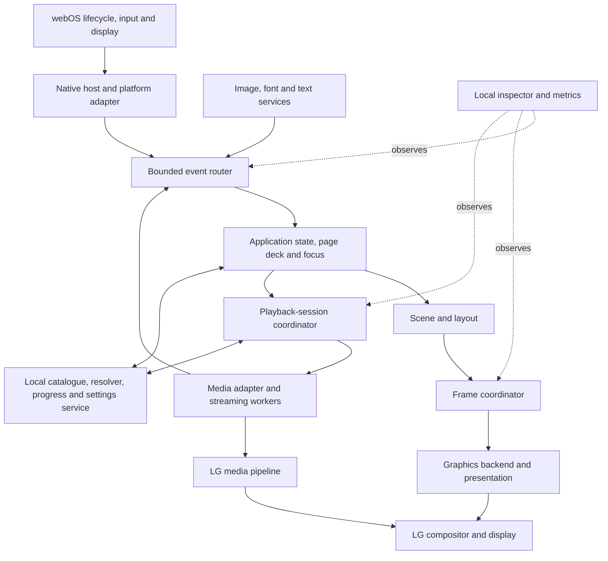

# Buna: complete native engine specification

**Status:** proposed finished-system specification, 15 October 2026.

**Product:** Bloob, an LG webOS TV streaming application with its own catalogue, source-resolution service and C++ interface.

**Premise:** imagine Buna has reached the reference application's level of responsiveness, playback coordination and operational quality. This document describes the engine that would support that result. It defines the target; it does not report that this engine has already been implemented or that performance parity has been measured.

## Contents

1. [What Buna is](#1-what-buna-is)
2. [System architecture and ownership](#2-system-architecture-and-ownership)
3. [Native host and platform boundary](#3-native-host-and-platform-boundary)
4. [Threads, events and time](#4-threads-events-and-time)
5. [Frame scheduling](#5-frame-scheduling)
6. [Scene, layout and graphics](#6-scene-layout-and-graphics)
7. [Images, fonts and resource budgets](#7-images-fonts-and-resource-budgets)
8. [Lists and nearby work](#8-lists-and-nearby-work)
9. [Input, focus and navigation](#9-input-focus-and-navigation)
10. [Motion, materials and presentation policy](#10-motion-materials-and-presentation-policy)
11. [Playback sessions and authoritative state](#11-playback-sessions-and-authoritative-state)
12. [Streaming and LG media adapters](#12-streaming-and-lg-media-adapters)
13. [Seeking, controls, tracks and captions](#13-seeking-controls-tracks-and-captions)
14. [Continuity, sources and the local service](#14-continuity-sources-and-the-local-service)
15. [Application and playback lifecycle](#15-application-and-playback-lifecycle)
16. [Accessibility](#16-accessibility)
17. [Errors and recovery](#17-errors-and-recovery)
18. [Inspection and performance](#18-inspection-and-performance)
19. [Packaging, persistence and compatibility](#19-packaging-persistence-and-compatibility)
20. [Complete journeys](#20-complete-journeys)
21. [Implementation contracts and completion](#21-implementation-contracts-and-completion)
22. [Reference evidence and Buna decisions](#22-reference-evidence-and-buna-decisions)

## 1. What Buna is

Buna is Bloob's application-owned native runtime. It supplies the machinery that turns remote input, application state, artwork and media events into a responsive television experience.

It owns:

- Startup, platform connections, lifecycle and shutdown.
- Event routing, frame scheduling and the application's retained scene.
- Layout, drawing, text, images, animation and resource accounting.
- Focus, page navigation and accessibility semantics.
- Playback-session state, clocks, commands and backend selection.
- Video/UI composition, capability reporting and recovery.
- Local diagnostics and bounded performance traces.

Bloob supplies product meaning: which catalogue rows to show, which episode to recommend, source-ranking policy, the visual theme, and the wording of screens. Its local service supplies metadata, source versions, resolution, progress storage and account settings. There is no Jellyfin dependency.

### 1.1 The chosen language boundary

The proposed implementation is a native C++ host with C++ screens and widgets. Node/V8 is not required by this architecture. A future scripting bridge can use the same event and scene contracts if there is a product reason to add one.

The reference uses JavaScript over native services. Buna preserves the responsibilities, scheduling principles and observable behaviour through its own implementation. It has its own module names, data structures and platform adapters.

### 1.2 What equivalent quality means

Equivalent quality means predictable interaction, bounded work, coherent playback state, controlled resources, recoverable failures and a continuous browsing-to-viewing experience on the supported TV configuration.

It does not require identical internal code, identical thread counts, identical appearance or matching a private runtime ABI. Unsupported hardware formats remain a platform capability question. Actual output and latency remain observable properties of the finished system.

## 2. System architecture and ownership

### 2.1 Single owners

| State or resource | Owner | Other modules receive |
| --- | --- | --- |
| Active page stack and overlay stack | Navigation controller | Stable page IDs and state snapshots |
| Focus and held-key interaction | Input/focus controller | Semantic actions and focus-change events |
| Widget and scene state | UI state thread | Immutable rendering snapshots |
| Graphics context, textures and render targets | Render backend | Resource handles and completion events |
| Image loading and decoded-image cache | Asset manager | Ready/error state and retained image handles |
| Active playback session | Session coordinator | Revisioned playback snapshots |
| Native media handle | Media adapter | Normalized state, clock and capability events |
| Pairing credentials and source unlocking | Local service | Pairing status and temporary resolved-source leases |
| Durable watch progress | Progress repository through the service | Versioned progress records |
| Diagnostic history | Inspector | Sanitized, bounded records |

No screen changes another screen's internal state. No button directly manipulates a decoder. No view reads a second media clock to compensate for a broken session clock.

### 2.2 Runtime-wide invariants

1. One owner handles a remote action in the current interaction layer.
2. One session is the foreground playback authority. Any additional prepared session is explicit and resource limited.
3. Asynchronous completions carry owner, generation and operation identity.
4. Graphics calls run on the backend's owning thread.
5. Resource handles remain valid until all submitted work that uses them has completed.
6. A screen's disappearance cancels or relinquishes its owned work.
7. Presentation, media and wall-clock time have distinct purposes.
8. Unknown capabilities, statistics and durations remain unknown.
9. Idle UI has no perpetual animation or application repaint loop.
10. Recoverable work cannot accumulate without a queue or memory bound.

## 3. Native host and platform boundary

### 3.1 Launch sequence

1. Read the installed application manifest and a compatible runtime configuration.
2. Initialize the platform adapter, monotonic clock and early diagnostic ring.
3. Establish the application surface and render a minimal launch state.
4. Register input, focus, visibility, display and close callbacks.
5. Start the UI state owner, graphics backend and bounded asset workers.
6. Connect to or launch Bloob's independently packaged local service.
7. Read durable settings and cached catalogue/progress data asynchronously.
8. Restore a valid navigation entry and display useful cached content.
9. Refresh content and prepare likely next screens at background priority.

Catalogue connectivity and source resolution do not block the first usable navigation surface. Startup records separate milestones for process entry, surface availability, first submitted UI frame and usable content.

### 3.2 Platform contract

| Platform facility | Contract Buna needs |
| --- | --- |
| Application lifecycle | Focus, visibility, minimize/restore, close and termination signals |
| Surface and presentation | Surface creation, alpha/composition requirements, dimensions, presentation callbacks and graphics-context lifetime |
| Remote input | Key identity, press/release/repeat, timestamps and any platform exit handling |
| Media | Open/prepare, play/pause, clock, seek, tracks, buffering, video placement and release, with per-backend capability flags |
| Display/audio information | Queryable capabilities and observed output information where exposed |
| Device accessibility | Reader, motion, transparency and text preferences where available |
| Storage and service launch | App-owned writable locations and predictable local-service lifecycle |
| Resource reporting | Available process, graphics and media statistics with explicit availability |

The proposed surface boundary is a Wayland/EGL adapter or another verified native surface interface on the target. Exact headers, linkable libraries, permissions and media entrypoints are platform implementation dependencies. This specification does not invent callable interfaces for unresolved LG functions.

The saved build proof establishes a matching ARM32 executable/loader on one TV. Platform support is defined by a tested application ABI and firmware/backend combination, independently of whether the TV kernel is 64-bit.

## 4. Threads, events and time

### 4.1 Execution domains

| Domain | Work | Boundary |
| --- | --- | --- |
| Platform event thread | Receives OS input, surface and lifecycle notifications | Performs short dispatch; no catalogue lookup or image decoding |
| UI state thread | Navigation, focus, application reducers, layout decisions and render-snapshot construction | Sole writer of application/widget state |
| Render owner | Graphics resource creation, command submission, presentation and deferred release | Owns graphics context; consumes immutable snapshots |
| Bounded asset workers | File reads, image decode and expensive text preparation | Return results through generation-checked events |
| Media adapter domains | Streaming, demux/source buffers and platform callbacks | Backend-owned; callbacks never mutate UI objects directly |
| Local service process | Catalogue, source lookup/unlocking, account storage and persistence | Communicates through explicit request/reply and subscription contracts |

The platform and render domains may share a thread when required by the surface API. Their ownership rules remain the same. Worker counts are configuration limits; starting one thread per image or episode is forbidden.

### 4.2 Event envelopes

Every asynchronous event identifies its event type, creation timestamp, owner ID, owner generation, operation ID and payload revision where applicable.

Before applying a completion, the receiver checks that its owner still exists, its generation is current and its operation is still relevant. Cancellation is best effort for physical work and definitive for accepting its result. A late reply may finish in a worker, but cannot reopen an abandoned movie or modify a destroyed widget.

### 4.3 Queue policy

- Lifecycle/close, new key actions and operation completions have reserved capacity.
- Repeated clock, pointer-position, geometry and progress updates can replace older equivalent updates for the same owner.
- Key repeat can be accumulated under an explicit held-key policy; press/release ordering is preserved.
- Rendering retains the newest usable scene snapshot instead of an unbounded history of obsolete frames.
- Optional prefetch is dropped or deferred before essential interaction work.
- Saturation records a counter and sheds optional work. Control events are not silently discarded.

### 4.4 Three clocks

| Clock | Purpose |
| --- | --- |
| Monotonic runtime clock | Animation, deadlines, input latency, queue age and local performance measurements |
| Authoritative media timeline | Position, seek, captions, chapters, progress and playback completion |
| Wall clock | Clock display, estimated finish time and durable cross-launch recency |

Changing the system clock cannot alter an animation or seek timeout. Runtime timestamps from a previous process are never used as durable time. Media discontinuities carry a timeline epoch and explicit mapping into the session's presentation timeline.

## 5. Frame scheduling

### 5.1 Reasons to wake

The UI requests work for input, state changes, visible asset completion, layout changes, active animation, caption transitions, relevant media changes or surface restoration. A media pipeline can keep presenting video while the app's overlay remains unchanged.

### 5.2 Frame transaction

1. Drain a bounded amount of eligible events, prioritizing interaction and lifecycle.
2. Apply state changes once on the UI owner.
3. Advance active animations to the current monotonic time.
4. Recompute affected layout and scene state.
5. Produce an immutable rendering snapshot and damage description.
6. Submit the newest ready snapshot when presentation capacity permits.
7. Record presentation feedback where available and retire completed resources.
8. Schedule the next actual deadline, or sleep if no work remains.

State updates are coalesced while a frame is pending. Animation progress is evaluated against time; the engine does not replay a long queue of missed visual steps after a stall. Spring integration has a bounded catch-up policy.

### 5.3 Presentation rules

- Follow the presentation cadence exposed by the active surface/display.
- Limit application frames in flight; the initial contract permits one submitted frame and one newer prepared snapshot.
- A later snapshot can replace an unsubmitted one. Submitted GPU work retains its resources until completion.
- Input is not delayed to wait for artwork, network replies or another animation to finish.
- Dirty scene state and framebuffer preservation are separate facts. Partial redraw is used only when the backend can establish valid preserved contents/damage. Otherwise the engine renders a complete frame for the current snapshot.
- Moving or shrinking content invalidates its previous and new bounds, including shadow/effect extents.
- Failed context or surface validity cancels partial-redraw assumptions and forces complete reconstruction.

An idle application has no recurring application-render timer. Essential platform/service activity is tracked separately; idle UI does not imply that the entire process or playing video does no work.

## 6. Scene, layout and graphics

### 6.1 Scene primitives

Buna provides containers, clipped groups, images, text, shapes, gradients, material/effect groups, controls, focus decoration and video-placement nodes. Each node has stable identity, bounds, transform, opacity, clipping, layer order and optional semantic accessibility data.

Rendering uses a retained scene with explicit invalidation. Widgets request changes; the graphics backend receives an immutable representation of the resulting frame. Layout or painting cannot initiate network requests as a side effect.

### 6.2 Layout model

- Keep logical design coordinates separate from surface resolution and asset resolution.
- Provide row/column, inset, overlay, fixed/aspect-constrained, scroll and virtualized-list layouts.
- Measure text through the same shaping rules used to draw it.
- Cache measured results against text, font, language, width, formatting and scale.
- Invalidate the dependent subtree when an input changes.
- Keep visual transforms for focus/animation separate from measured list geometry unless the component explicitly requests relayout.
- Define rounding at the shared coordinate boundary to avoid neighboring components disagreeing about pixel edges.

The reference's 1920×1080 design canvas and area-based scaling are available study inputs. Buna exposes a versioned logical-canvas policy, safe insets and output scale. Display resolution, UI rendering resolution and video resolution are independent configuration values.

### 6.3 Rendering strategy

The backend batches compatible commands where ordering permits, reuses textures and text resources, respects clipping and avoids redundant state changes. Offscreen effect surfaces are explicitly budgeted. Drawing order is preserved across translucent layers; batching cannot change composition results.

Glass treatments use bounded effect areas, cached/static results where valid and solid/translucent fallback styles. Full-screen blur or repeated offscreen surfaces require explicit policy approval. A changing video behind an effect invalidates any assumption that the background is static.

The renderer must remain correct if an optimization is disabled. Correct clipping, transparent clears, typography and video visibility are baseline requirements.

### 6.4 Video composition contract

The session provides a video-surface handle and desired placement. The compositor adapter declares whether the backend uses a video underlay, overlay, texture or another verified mode.

For an underlay, Buna preserves transparency in the video region and draws controls above it. For a texture path, the renderer uses the adapter's synchronization and colour/composition rules. Rectangles are converted into the platform's coordinate space in one place, with aspect fit/crop and display rotation handled explicitly.

Video placement changes are coalesced and redundant geometry updates are omitted. Animated UI need not issue media-window calls on every frame when the backend cannot support them smoothly.

Screenshots report whether they include the video plane. A compositor capture containing only controls cannot establish that the physical display has no video.

## 7. Images, fonts and resource budgets

### 7.1 Image lifecycle

An image request has a stable content key, target dimensions, crop/fit, colour/alpha requirements, priority and owner. Its states are Requested, Loading, Decoding, Ready, Failed or Cancelled.

Visible/focused assets outrank nearby assets; speculative artwork is lowest priority. Requests sharing a compatible cache key share physical work. Cancelling one owner does not cancel another owner's live request.

An image enters the graphics path through a retained handle. Decoding work stays off the interaction path, and texture uploads are bounded per frame. Oversized inputs are constrained before allocating full decoded output where the decoder permits it. Allocation failures yield a usable placeholder and a diagnostic event.

### 7.2 Transition readiness

The currently visible image remains until its replacement reaches Ready or a terminal failure policy. A failed incoming image uses a defined fallback; an endless animation does not wait for it forever. Superseded requests cannot transition a newer card back to an older image.

Artwork colour metadata is an optional input. Missing or unsuitable values resolve to theme defaults with legibility protection. Palette extraction is scheduled background work when used.

### 7.3 Fonts and text

The text service owns language-aware shaping, bidirectional ordering, glyph fallback, measurement, line breaking, truncation and glyph/atlas caches. Cache identity includes scale, font variation/features and accessibility settings.

Theme typography refers to roles. Font loading has a fallback path; switching to a loaded font invalidates relevant measurement and drawing. A measured line and its rendered glyphs use the same font resolution result. Numeric player clocks can request tabular figures without making every label monospaced.

### 7.4 Budget contract

| Resource | Limit and eviction principle |
| --- | --- |
| Encoded/disk image cache | Bounded storage; least-recently-used unpinned entries first |
| Decoded CPU images | Byte-based limit and decode reservations; cancel speculative work first |
| GPU textures | Byte-based limit; preserve current critical resources, evict unreferenced/offscreen assets first |
| Glyph/text caches | Bounded atlases and measurement entries; retire unused generations |
| Offscreen material surfaces | Per-frame and retained-byte limits; reduce optional effects before input responsiveness |
| Metadata/list materialization | Explicit nearby windows and count/byte limits |
| Media buffers | Adapter-specific controls and reported usage; external allocation remains separately accounted |
| Event/inspection history | Fixed capacity with overflow counters |

Limits are supplied by a versioned device profile, in bytes/counts with named soft and hard thresholds. Admission includes in-flight allocations, not only completed assets. Shared allocations are counted once. The profile has a conservative default; no guessed memory allowance is attributed to the reference app.

Memory pressure cancels prefetch, evicts optional resources, reduces optional effect work and retains a navigable fallback. Resources referenced by submitted GPU work are released after the completion boundary.

## 8. Lists and nearby work

### 8.1 Scrolling contract

Lists store lightweight item descriptions with stable IDs. Uniform rows use direct index/offset calculation; variable-size rows use an indexed cumulative-size structure.

Drawing/layout traversal starts at the relevant viewport offset and proceeds through the visible extent, overscan allowance and focus-navigation needs. Full widgets are materialized within a bounded working set. Overscan and retention are explicit policies, not assumptions that every offscreen item must immediately disappear.

The focus controller can obtain a candidate's logical geometry without materializing an entire catalogue. Discovering a far-away candidate schedules the bounded realization needed to reach it.

### 8.2 Data windows

Episode and related-content fetches have a selected-ID anchor, debounce, neighborhood and retention policy. Rapid movement replaces the pending anchor. Cached data can appear immediately; arriving data applies only to the current request generation.

The reference's roughly ±10 episode neighborhood, wider retention margins, 500 ms episode delay and 300 ms related-content delay are reference defaults. Buna makes these named configuration fields and preserves their distinct meanings. They are not delays imposed on moving focus.

### 8.3 Refresh and restoration

Refresh reconciles by stable item ID, preserving compatible layout state and scroll position. If the focused item disappears, choose the nearest valid item in its prior logical position. If the row disappears, choose the nearest meaningful surviving row and ensure the selection is visible.

Empty, loading, cached/stale, failed and complete lists are separate states. An empty successful catalogue response must not masquerade as an indefinite spinner.

## 9. Input, focus and navigation

### 9.1 Remote input

The platform adapter normalizes keys into directional, select, Back, transport and supported auxiliary actions. Events retain press/release/repeat information. One discrete select or play/pause action commits once; receiving both key down and key up cannot toggle playback twice.

Held directional navigation, held seeking and text editing have separate repeat policies. Releasing, losing focus or changing interaction layer cancels the old held-key action.

### 9.2 Focus ownership

Focus belongs to the top interactive layer. A modal temporarily captures focus and remembers its return anchor. Disabled and hidden controls are excluded from ordinary traversal.

Within a row, navigation follows logical order. Between rows, the controller preserves the horizontal anchor and chooses a suitable visible/focusable item. Logical leading/trailing direction respects the active layout direction. Focus movement requests scrolling when needed without waiting for the scroll animation to finish.

Focus arrival updates visual selection, semantic accessibility state and any deliberate prefetch trigger in one state transaction. Input repeat may move again while the previous focus animation is still settling.

### 9.3 Navigation deck

Page states include Created, Entering, Active, Covered/Idle, Leaving and Disposed. Screens retain small restoration records independently of expensive render resources. Returning to Home can restore selection even if its textures were evicted during playback.

Deep links create a valid stack and stable return destination. Invalid or unavailable targets resolve to a recovery destination without a broken Back chain.

### 9.4 Default Back policy

| Current interaction | Back result |
| --- | --- |
| Dialog, track menu or source-choice overlay | Close that layer; restore its parent focus |
| Seek preview | Cancel preview and return to acknowledged playback position |
| Player HUD visible | Hide the HUD if no higher-priority interaction needs it |
| Player HUD hidden | Leave playback, checkpoint progress and release the session |
| Detail or source page | Pop to its parent and restore context |
| Root page scrolled away from its entry | Return to the root entry position under product policy |
| Root at its entry | Apply Bloob's explicit app-exit policy |

This table is the proposed Bloob interaction contract. It does not claim that every reference screen uses this exact ordering. Platform-dedicated exit actions remain separate from ordinary Back.

## 10. Motion, materials and presentation policy

Animations have an owner, affected properties, start/current/target state, time source and completion/cancellation rule. A newer target retargets an existing interaction instead of placing another complete animation behind it. Springs preserve useful continuity without unbounded catch-up work.

Opacity, transform, shadow and layout animation are distinguished. A focus enlargement normally changes presentation without remeasuring an entire shelf. Interrupted page transitions reconcile to a valid navigation state and release their resources.

The theme supplies role-based typography, semantic colours, spacing, safe areas, radii, shadows and motion tokens. Component variants override shared defaults explicitly. The [extracted token catalogue](../research/Elements-of-A-design-tokens.md) supplies reference values and conditional rules; Bloob's theme selects its own values and aesthetic.

Capability policy has named rendering tiers, verified backend limits and accessibility overrides. Reduce Motion supplies a coherent static/reduced alternative. Reduce Transparency replaces expensive/translucent treatments with legible solid treatments. Disabling an effect cannot remove focus feedback or an essential control.

Automatic degradation based on live measurements would be a separate Buna feature with hysteresis and recovery policy. It is not assumed from the reference's static presentation tiers. The initial implementation uses an explicit device profile and diagnostic override.

## 11. Playback sessions and authoritative state

### 11.1 Session ownership

A session is created from a semantic play intent plus a resolved source. It owns the active media adapter, selected tracks, timeline mapping, requested transport intent, commands, callbacks, reporting and lifetime.

The player surface reads revisioned snapshots and sends commands. It never substitutes catalogue duration for an authoritative file duration or maintains an independent seek clock.

### 11.2 State axes

| Axis | Values or contents |
| --- | --- |
| Lifetime | Created, Opening, Active, Closing, Closed |
| User transport intent | Play or Pause |
| Backend transport | Unknown, Preparing, Ready, Playing, Paused, Ended, Failed |
| Active operations | Initial buffering, rebuffering, seeking, track switch and recovery, identified separately where they overlap |
| Timeline | Confirmed position, known/unknown duration, seekable intervals, live edge, clock freshness and epoch |
| Selection | Media-source identity, audio/subtitle identity and preferences |
| Capability | Supported, unsupported, unavailable or unknown per operation |
| Failure | Category, operation, recoverability and available actions |

Displayed state derives from these axes with explicit priority: closing/error/recovery and blocking operations are represented before ordinary playing/paused state. Buffer-induced backend pauses do not overwrite the user's Play intent. A track operation or internal restart cannot create rapid fake Playing/Paused UI toggles.

### 11.3 Snapshot contract

A snapshot contains session ID/revision, canonical item/episode and source identity, state axes, authoritative clock data, buffered/seekable ranges, selected/available tracks, operation statuses, capability reasons, safe presentation metadata and progress/reporting status.

Clock values have explicit units and origin. Durations and offsets use sufficient integer precision for long/live timelines. Unknown duration is optional data, not zero. Resolved URLs, account keys and bearer headers are excluded from view/inspection snapshots.

### 11.4 Clock rules

- Backend media time is authoritative.
- The UI may interpolate a fresh playing clock between callbacks using a monotonic anchor and rate.
- Interpolation stops during pause, seek, buffering, detachment, stale clock or error, and cannot run beyond known limits.
- Backend corrections replace the prediction; a requested target never becomes confirmation by itself.
- A temporarily missing duration preserves the last valid value for the same source/epoch where appropriate. Source replacement resets its provenance.
- File timestamps, programme offsets and live-window time are normalized once in the adapter/session boundary.

Startup tracks distinct milestones: source resolved, backend prepared, transport started and first video frame presented. When the backend exposes only transport start, reporting labels that event accurately instead of calling it visible first frame.

## 12. Streaming and LG media adapters

### 12.1 Two backend input contracts

| Route | Responsibility |
| --- | --- |
| Native URI route | Give a supported platform backend a source lease; normalize its state, time, tracks, placement and errors |
| Segmented/sample route | Fetch and parse supported streams, perform adaptive selection/demux/buffering, then feed compressed timestamped samples through a verified LG media interface |

Adapters declare their capabilities individually. A URI backend exposing playback but no track switching cannot advertise working audio/subtitle selection. A segmented backend can expose sample control only when its actual platform integration supports it.

Streaming, parsing and demux are worker work. Existing suitable components can implement these contracts after compatibility and redistribution requirements are checked. The engine contract does not depend on writing a new decoder or selecting a particular third-party library here.

### 12.2 Sample and buffer rules

- Samples carry track identity, timestamp/duration units, decode/presentation timing where required, format description and discontinuity epoch.
- Queues have byte and media-time limits.
- Submission honors downstream backpressure and retains ownership until the submission contract permits release.
- Read position advances after successful acceptance.
- Seeking and source changes flush or invalidate obsolete queued data through a new epoch.
- End-of-stream is explicit per relevant track and is distinct from a transient empty buffer.
- Startup/resume buffering gates and underrun recovery are controlled state transitions.

LG remains responsible for the hardware media pipeline. Buna manages the work and state that its adapter contract exposes.

### 12.3 Adaptive quality and source versions

An adaptive manifest can expose compatible renditions that share one playback timeline. Selection uses capability, throughput confidence, buffer and startup cost. Changes have hysteresis to avoid oscillation and do not choose unsupported codec/range combinations.

AllDebrid source versions are independent files/releases unless proven otherwise. Changing a 4K file to a 1080p file is a source/session handoff with validation of timeline and resume mapping. It is not automatically an adaptive-bitrate switch.

### 12.4 Output truth

Keep declared source properties, backend-detected stream properties and observed output properties separate. A filename claiming Atmos or HDR cannot establish the active output mode. Where the platform exposes output state, show it with its provenance; otherwise report it as unknown.

Frame-rate matching, passthrough and HDR output are capability-gated adapter operations. The studied LG reference configuration disables content frame-rate matching; Buna must not assume it is available merely because a generic runtime option exists.

## 13. Seeking, controls, tracks and captions

### 13.1 Seek transaction

The session distinguishes preview target, submitted target, acknowledged landing position and thumbnail time.

Directional seeking updates preview immediately, accumulates held input under a defined acceleration policy and submits the latest target after a short coalescing interval or explicit commit. The reference's 400 ms relative-seek interval is an available starting token, independently of focus/animation durations.

On commit, clamp to a valid seekable interval, issue an operation ID and hold the preview as pending. Ignore obsolete pre-seek clock events. On confirmation, settle to the actual landing time and release the pending state. On timeout/failure, return to the current authoritative clock and expose retry/recovery where appropriate. A seek cannot be reported successful merely because the UI moved its thumb.

Live seeking uses actual moving seekable intervals and a defined live-edge tolerance. A manifest gap or unavailable chapter target uses the nearest valid landing policy with actual confirmation.

### 13.2 Player presentation modes

| Mode | Purpose | Exit/visibility rule |
| --- | --- | --- |
| Hidden | Unobstructed viewing | Relevant input or playback event reveals appropriate controls |
| Full HUD | Transport, timeline and primary actions | Dismiss according to mode/activity policy |
| Reduced HUD | Lightweight seek/transport feedback | Settle or expand according to interaction |
| Menu/dialog | Tracks, chapters, details or recovery | Captures focus; Back restores parent |
| Loading/buffering | Explain a blocking operation | Spinner has a delay to suppress brief flashes; operation state is immediate |
| Post-play | Replay/next item/exit | Explicit cancellation and next-item ownership |

The reference's 5/8/20-second dismissal classes and reader multiplier are documented presets, not unconditional engine delays. The configured controller suppresses dismissal during active preview, dragging and required interactions. Pause, menus and accessibility have explicit policies rather than scattered timeout resets.

### 13.3 Audio/subtitle selection

Track records include stable per-source ID, language, supplied name, role flags such as descriptive audio/forced/SDH, and codec/channel details when known. Menus show useful available metadata without manufacturing missing channel or format information.

Selection waits for adapter acknowledgment. Failure keeps the menu actionable and identifies the limitation. Track indexes and IDs are not carried blindly into another source or episode.

Persistent preferences describe language, role and subtitle mode: Off, Automatic/Forced, or a selected language/role. Each new source resolves them against its actual tracks. Exact preference wins; otherwise use a defined compatible fallback and keep the selected result visible. Explicit Off remains Off; automatic forced-caption rules apply only in the corresponding mode.

### 13.4 Caption presentation

Use one active caption-rendering owner per presentation path. Native captions and app-drawn captions cannot both render the same selected track.

App-rendered captions follow the authoritative media timeline, with pause/seek/discontinuity flushing. Layout uses the video presentation rectangle, user styling and safe insets. Visible controls, menus and thumbnails contribute an obstruction area; captions move only as required and return smoothly when it clears.

Caption size is an explicit role relative to the logical video/UI geometry. A physical-resolution change cannot accidentally multiply it twice. Cue layout and glyph shaping are cached; updates occur at cue boundaries, styling changes or geometry changes.

### 13.5 Chapters, skip actions and post-play

Chapters and skip-intro/recap ranges require timestamped source/service metadata. Missing data produces no invented action. Actions create normal validated seek transactions.

At an actual playback end, commit final progress, stop ordinary transport timers and enter one post-play decision. Autoplay requires an eligible next item, an enabled preference and a cancellable countdown. Leaving the page, selecting another action or pressing Back cancels the pending transition.

Preparing the next item may fetch metadata, resolve its source or preload supported media. Creating a second active decoder requires explicit platform capacity. Preloading cannot evict the resources needed by the current foreground player.

## 14. Continuity, sources and the local service

### 14.1 Data and command contracts

| Service domain | Required information |
| --- | --- |
| Catalogue | Stable item/series/season/episode IDs, ordering, text, artwork descriptors and pagination |
| Versions | Candidate ID, availability, declared quality/audio/language, ranking reason and provenance |
| Source lease | Temporary playable location kept inside the session boundary, transport, expiry/refresh hints and source identity |
| Progress | Canonical identity, confirmed position, duration provenance, completion state, source/edit identity and revision |
| Preferences | Language/track, autoplay, accessibility, source preference and playback settings |
| Pairing | Connected/disconnected/expired state and durable-storage status, without returning secrets to screens |

Existing endpoints sit behind these domain adapters. The engine does not embed scraping, catalogue ordering or account unlocking inside widgets or the renderer.

### 14.2 Watch flow

One watch-attempt ID follows selection, source discovery, pairing if required, resolution, session preparation and playback. Cancelling it invalidates every dependent reply. A newer attempt cannot be replaced by a late success from an older one.

The UI can continue browsing while preparatory work runs, but only the current foreground intent can open a player. Resolve retries keep stable user context and offer another source when the current one fails.

### 14.3 Progress and resume

Progress follows acknowledged media time. Checkpoint periodically and on pause, background, source handoff, exit and completion, coalescing routine writes. Writes are revisioned and idempotent; an old delayed checkpoint cannot overwrite a newer one.

The product's server decides Resume, Next Episode, watched status and continue-watching ordering from explicit rules. Buna supplies accurate events and positions. Completion thresholds are product settings, not inferred universal rules of the reference engine.

Resume uses a canonical timeline plus source/edit identity. A different cut or episode file may require duration/timeline validation before applying an old offset. A source index is not a durable episode identity.

Service connectivity loss retains an in-memory/latest durable progress checkpoint and retries reconciliation when available. Playback can continue while its already resolved lease remains usable.

### 14.4 Expiry and source recovery

The resolver supplies refresh/re-resolution semantics for renewable leases. On an applicable failure, the session preserves its confirmed position, requests a fresh lease under the same watch intent, validates the replacement and resumes through a new operation epoch.

Automatic recovery is bounded and category-specific. Repeated failure exposes Try Again, Choose Another Version and Exit. An arbitrary source is never assumed to be renewable. This is Buna/Bloob product design; a generic debrid renewal flow was not established in the reference.

## 15. Application and playback lifecycle

Focus, visibility, playback intent and platform attachment are separate state inputs.

| Event | Required response |
| --- | --- |
| Temporary focus loss | Apply configured pause/input policy; retain navigation and prior intent |
| Covered app-owned page | Idle unrelated work; retain small restoration state |
| Minimize/background | Checkpoint, cancel speculative work and UI animation, release/detach media resources according to backend policy |
| Restore/foreground | Recreate surfaces/resources if needed, reattach media, restore timeline and re-evaluate current user intent |
| User pause while an interruption is active | Update intent generation so old automatic-resume work cannot override it |
| Video surface/context loss | Re-establish composition and current snapshot before announcing recovered presentation |
| Session exit | Cancel operations, checkpoint, stop backend, release video placement and restore parent focus |
| App close | Stop acceptance of new work, bound final persistence/cleanup, stop service dependencies as owned and release platform resources |

Automatic resume occurs only if the interrupted session wanted playback, remains the current session and has no later user pause/cancel. Receiving focus alone is not an unconditional Play command.

Screensaver suspension is reference-counted by actual playback need and balanced on every exit/error path. Cleanup is idempotent. Repeated stop/close or late callbacks cannot recreate a closed player.

No installation, cleanup or migration in this specification authorizes deleting existing TV applications, account data or retained research artifacts.

## 16. Accessibility

The semantic tree accompanies the visual tree with stable IDs, labels, roles, enabled/selected state, position/count, container relationships and available actions.

Focus changes drive consistent visual and spoken feedback. Pending speech is cancelled or queued by meaning; rapid traversal does not narrate every obsolete card. Dynamic content updates preserve the user's current task and announce only relevant changes.

The accessibility adapter uses a verified platform semantic bridge or app-owned TTS integration with clear ownership. It reports the available path. The reference's optional tree bridge and app-owned reader are separate mechanisms; one does not prove the other is enabled on LG.

Reduced motion, transparency, text sizing and caption preferences flow through the same scene/layout contracts. Automatic hero advancement respects reader and motion policy. Essential controls remain reachable without pointer input, colour discrimination or animation cues.

## 17. Errors and recovery

### 17.1 Structured errors

Errors carry domain, operation, retryability, session/request identity, safe user description and available actions. Internal diagnostic details are separated from screen text.

| Failure | Behaviour |
| --- | --- |
| Artwork/font unavailable | Keep layout stable; show fallback and permit navigation |
| Catalogue refresh fails | Retain usable cached content; expose retry and stale state |
| Source resolution fails | Retain selected title/version context; retry or choose another |
| Unsupported media operation | Report capability/reason; retain working playback where possible |
| Network interruption | Coordinate buffering/retry with session intent and bounded recovery |
| Seek/track operation fails | Return to acknowledged state and retain usable controls |
| Service disconnects | Reconnect with bounded backoff; preserve state and local checkpoints |
| Graphics allocation/context fails | Reduce optional work, rebuild or show a minimal recovery surface |
| Fatal media failure | Stop the failed backend and offer a defined recovery path |

### 17.2 Recovery discipline

Retries use category-specific limits, backoff and cancellation. Rapid repeated input cannot spawn overlapping recovery loops. Recovery never steals focus after the user leaves.

A transient state and a terminal failure are distinguishable. Spinners belong to named operations with a deadline/recovery path. A missing duration or unavailable statistic does not become a fatal error by itself.

If a graphics context is recreated, all dependent handles are invalidated together and re-uploaded from valid retained resources. Stale GPU handles are never treated as ready textures.

## 18. Inspection and performance

### 18.1 Inspector contract

Buna exposes a local diagnostic interface for state snapshots, recent events, active operations, resource usage and available media statistics. It supports bounded event subscription with sequence numbers and overflow detection.

The read interface includes runtime/build/profile, page/focus stack, pending jobs, frame state, image/font caches, session state, clock provenance, backend capabilities, tracks, lifecycle and recent safe errors.

The interface is local and restricted to the intended developer connection. Read inspection and active control are separate capabilities. Synthetic input or playback commands are enabled only through an explicit development mode and remain distinguishable from physical input in traces.

Resolved URLs, credentials, bearer headers and raw account data are excluded. Text entry and detailed content identifiers are omitted or locally pseudonymized by default. Trace storage has a fixed byte/count limit.

### 18.2 Causal trace

An interaction trace can correlate:

remote event → semantic action → state revision → scene snapshot → render submission → presentation feedback.

A watch trace additionally correlates source resolution, backend preparation, transport state, confirmed clock, first-frame evidence and teardown. Each event identifies its clock domain. Missing presentation feedback is reported as unavailable, so CPU submission time cannot masquerade as physical display latency.

### 18.3 Metrics

| Category | Metrics |
| --- | --- |
| Interaction | Input queue age, input-to-state, input-to-submission and input-to-presentation where observable |
| Frames | State/layout/build/submit/GPU times where available, frame intervals, missed deadlines and frames in flight |
| Assets | Ready/loading/error counts, deduplication, decode/upload times, cache hit rate and bytes by allocation type |
| Memory | Owned CPU/GPU resources, in-flight reservations and process/media observations with availability |
| Playback | Resolution/prepare/first-frame stages, seek target/landing/duration, stalls, track changes and teardown |
| Lifecycle | Detach/attach time, restored state, outstanding work after exit |
| Quality | Actual backend/rendition/output provenance and available decoded/dropped-frame counters |

Missing counters are unavailable. A zero supplied by a backend fallback cannot be reported as a measured zero.

### 18.4 Proposed quality objectives

These are Buna design objectives, not recovered reference benchmarks or claims about the current prototype.

- At a supported 60 Hz UI presentation mode, active navigation/animation targets one frame per refresh, with work organized around the approximately 16.67 ms interval. Other modes use their actual cadence.
- Visible focus/press feedback is eligible for the next available frame; asset/network work cannot gate that feedback.
- A useful planning objective is input-to-presented feedback p95 ≤50 ms on the chosen reference TV. It requires an observable presentation boundary; without one, report the measurable interval separately.
- No new app-render frames are scheduled solely because a static screen has been sitting open.
- Queue depths and owned resources remain within profile limits, and repeated equivalent journeys do not create unbounded retained growth.
- Playback startup is divided into resolution, transport, preparation and presentation. No single fixed Internet-startup promise is invented.
- Seeking acknowledges pending work immediately, then reports the real landing point. Backend/network limits do not leave an indefinitely fictional timeline.
- Optional image/effect/prefetch work yields before essential interaction and playback coordination.

The reference's actual latency/memory budgets were not recovered. A performance-equivalence statement ultimately needs comparable measurements; this document supplies the machinery and definitions needed for them.

## 19. Packaging, persistence and compatibility

Ship Bloob's native executable, original runtime modules, its selected graphics/media dependencies, theme/assets, compatibility profile and independent local service as a coherent versioned product.

Build compatibility covers instruction set, floating-point calling convention, loader, libc and dependency versions. A successful standalone ABI probe does not substitute for linked graphics/media compatibility.

Settings and progress use schema versions and atomic durable writes. Routine progress writes are coalesced; critical pause/exit checkpoints receive priority without blocking the UI thread. Account storage remains service-owned and survives normal application restarts. Migration preserves recoverable prior data and does not clear pairing as a routine update action.

Native code and resource/service versions declare compatibility. Updates activate complete compatible sets through the platform package mechanism or an explicitly designed atomic update mechanism. Recovery/rollback must preserve settings and progress. A custom remote bundle updater is an optional product decision, not a requirement to reproduce the reference runtime.

Backend support is a table of verified operations per TV/firmware/backend combination. Unsupported private entrypoints never become assumed shipping dependencies. The engine may support additional native adapters as verified implementations become available.

## 20. Complete journeys

### 20.1 Launch and browse

Bloob opens a native application surface. A useful initial scene appears, then cached catalogue rows become available. The service refreshes data behind stable IDs. The focused tile can respond before its artwork finishes. Only nearby content becomes expensive widgets or decoded textures.

When the user moves right, one semantic event changes focus. The existing focus animation retargets, the scene invalidates the relevant bounds and the next eligible frame shows feedback. Old image requests lose priority; a short-lived focus does not force every detail lookup to finish.

### 20.2 Open a movie and play

1. Selecting a tile emits Open Details with a canonical ID.
2. Navigation records the shelf/item/scroll return anchor.
3. Details opens with available metadata and prepared artwork/fallback.
4. Play creates a watch intent; the service returns ranked source versions or resolves the selected one.
5. Cancellation and generation checks remain active throughout.
6. A session selects a capable adapter, prepares media and establishes video composition.
7. Controls display session snapshots and genuine timeline availability.
8. Playback proceeds through LG's media pipeline while the UI schedules only needed work.

### 20.3 Seek and switch tracks

Directional input immediately changes a preview target. A bounded thumbnail request may follow; it cannot delay the preview. The session commits one current seek, shows pending state and settles on the acknowledged clock.

Opening audio/subtitle options captures focus. Choices come from actual backend track records. Selecting a track starts a named operation. Acknowledgment updates the menu and persists a language/role preference; failure leaves working controls and explains the reason.

### 20.4 Leave playback

Back dismisses the nearest active interaction according to policy. Leaving the session checkpoints confirmed progress, cancels its operations, releases or stops media resources, restores screensaver policy and returns to the remembered title context.

Home/details can reconstruct evicted artwork without losing selection. Progress updates reconcile by revision. A late callback from the exited player cannot reopen it or change a new session's seek bar.

### 20.5 Finish an episode

The session receives actual end state, checkpoints completion and enters post-play. Bloob's continuity service supplies the next eligible episode. The user can play, cancel, replay or return. If autoplay is enabled, the countdown has one owner and cancellation rule. Any prepared next source becomes active only through a session handoff that respects decoder and resource capacity.

## 21. Implementation contracts and completion

### 21.1 Required module deliverables

| Module | Must define before implementation |
| --- | --- |
| Host/platform | ABI/dependencies, lifecycle and input mapping, surface ownership, presentation feedback and shutdown |
| Event router | Event identities, queue bounds, priorities, coalescing and cancellation |
| Frame coordinator | Wake reasons, state/snapshot boundaries, frames in flight, damage validity and presentation evidence |
| Scene/layout | Node ownership, invalidation, measurement, clipping, transforms and stable identity |
| Graphics | Primitive/material capabilities, resource lifetime, context loss and composition mode |
| Assets/text | Cache keys, worker limits, admission/eviction, fonts/shaping, readiness and fallback |
| Lists/focus | Offset indexing, realization/retention, directional navigation and restoration |
| Playback session | State axes, authoritative clock, operation generations, commands and snapshot schema |
| Media adapters | Supported operations, sample/URI ownership, seek acknowledgment, tracks, video geometry and cleanup |
| Service/continuity | Domain identities, source leases, cancellation, settings/progress revisions and next-item policy |
| Accessibility | Semantic ownership, reader/platform integration and reduced-effect alternatives |
| Inspector | Safe schemas, trace clocks/correlation, bounds and metric availability |

### 21.2 Dependency order

1. Establish native host, input, surface and one frame-on-demand path.
2. Establish event ownership, scheduling, scene resources and context/lifecycle recovery.
3. Add list/focus, image/text services and coherent navigation restoration.
4. Complete one media adapter with accurate state, clock, seek, tracks/capability reasons and video composition.
5. Connect the catalogue/resolver/progress contracts through a complete watch journey.
6. Add the additional streaming route, preloading and optional presentation effects within established budgets.
7. Finish accessibility, recovery, packaging and performance objectives using the inspector already present in earlier layers.

Each step produces a working integrated capability. Instrumentation accompanies the layers as they are built; it is not postponed until a finished interface hides ownership problems.

### 21.3 Definition of complete

The engine is complete for a declared supported TV/backend configuration when the journeys above work coherently, every active operation has an owner/deadline/cancellation rule, resource use is bounded, advertised media operations are genuine, lifecycle returns to a usable state and performance objectives have observable evidence.

Verification follows one end-to-end acceptance journey plus focused checks for concrete failure paths: interrupted operations, missing assets/tracks, background/restore and resource release. This specification does not require an open-ended recording campaign or repeated broad test cycles before implementation.

It is a complete runtime foundation when Bloob screens consume its contracts consistently. A visual refresh alone, an ARM loader probe or one successful clip cannot establish that completion.

## 22. Reference evidence and Buna decisions

### 22.1 Reading the authority of this document

The architectural contracts above are proposed Buna decisions unless explicitly attributed to a recovered reference mechanism. Predicted benefits are engineering reasoning. This writing pass uses the retained studies and performs no fresh native decompilation, TV observation or benchmark.

The historical prototype/native-host state is documented in [the native target](Buna-native-runtime-target.md) and [the ARM build proof](../native-host/README.md). This target specification does not revise their implementation status or claim to audit a newer build elsewhere.

### 22.2 Recovered mechanisms supporting the design

| Evidence | Reference mechanism | Source anchor |
| --- | --- | --- |
| R01 | Native setup, Node/V8 host, input/frame bridge | [Runtime study](../research/Luna-runtime-architecture.md), AppEngine::setup/run, Luna_Application_Wrapper |
| R02 | Coalesced pending frame requests and native wakeup | [Runtime study](../research/Luna-runtime-architecture.md), AppEngine::internalDraw, NodeJsMT::doCallback/asyncCallbackMain |
| R03 | Dirty-tree idle path and separate rendering stages | [Runtime study](../research/Luna-runtime-architecture.md), Gfx::IEngine::processFrame/renderFrame |
| R04 | Image/font asynchronous work and video drawing interface | [Runtime study](../research/Luna-runtime-architecture.md), ImageServer::frameBegin/frameDone, FontServer::requestFontLoad, DrawingContext::drawVideo |
| R05 | Indexed list lookup, bounded traversal and lazy realization | [UI findings](../research/question-ui-findings.md), app.js factory 96184, bytes 2688398–2710391 |
| R06 | Readiness-based artwork, size/crop/quality policy | [UI findings](../research/question-ui-findings.md), Artwork factory 62062, ProductPage background transition |
| R07 | Focus/selection restoration | [UI findings](../research/question-ui-findings.md), mimic factory 44379, bytes 298054–300002 |
| R08 | Nearby episode windows, delayed related fetch, version-token rejection | [UI findings](../research/question-ui-findings.md), ProductPage episode paging and SuperBrowse related shelves |
| R09 | Motion/capability gates and reader semantics | [UI findings](../research/question-ui-findings.md), presentation profile and ScreenReader factory 8824 |
| R10 | Session/adapter ownership, clock/seek/track and lifecycle rules | [Playback findings](../research/question-playback-findings.md), PlaybackSession, PlayerStore adapters and player controllers |
| R11 | Native samples, downstream backpressure, buffer gates and release | [System map](../research/Elements-of-A-system-map.md), TrackPump, MsePlayer, LgEsPlayerPalImpl |
| R12 | Native resource counters and bounded reporting | [Operations findings](../research/question-operations-findings.md), PerformanceCounters::getJsonStats and reporter policies |
| R13 | Staged chunks and saved update/base relationship | [JetPack study](../research/jetpack-analysis-2026-10-14.md), JSUpdater and bootstrap |
| R14 | Exact foundation/component/player design declarations | [Design tokens](../research/Elements-of-A-design-tokens.md), saved build 16.4.4.J34L139 and source hashes |

### 22.3 Important Buna choices added here

- C++ application/widgets with an optional scripting boundary.
- The ownership table, bounded queue contract and immutable render snapshots.
- Explicit CPU/GPU admission budgets and a device-profile schema.
- The normalized session state axes and uniform capability/clock provenance.
- The proposed default Back ordering and source-lease renewal contract.
- Revisioned local-service continuity/persistence and an independent service package.
- A safe local inspector with causal input-to-presentation traces.
- The proposed performance objectives and completion definition.

These choices make the recovered ideas implementable as a coherent original engine. They are not presented as recovered private specifications or measured reference results.

### 22.4 Boundaries still requiring a concrete implementation

The available platform surface/media interfaces, final graphics backend, exact device budgets and supported output/track features must be established for each declared target. Some native graphics calls and final video-plane behaviour remain unresolved in the reference study. An implementation can satisfy the contracts through its own verified platform route.

The finished product described here opens as Bloob's native application, renders its own interface through Buna, keeps user context through navigation and playback, and coordinates LG media output with accurate, responsive app-owned controls.
