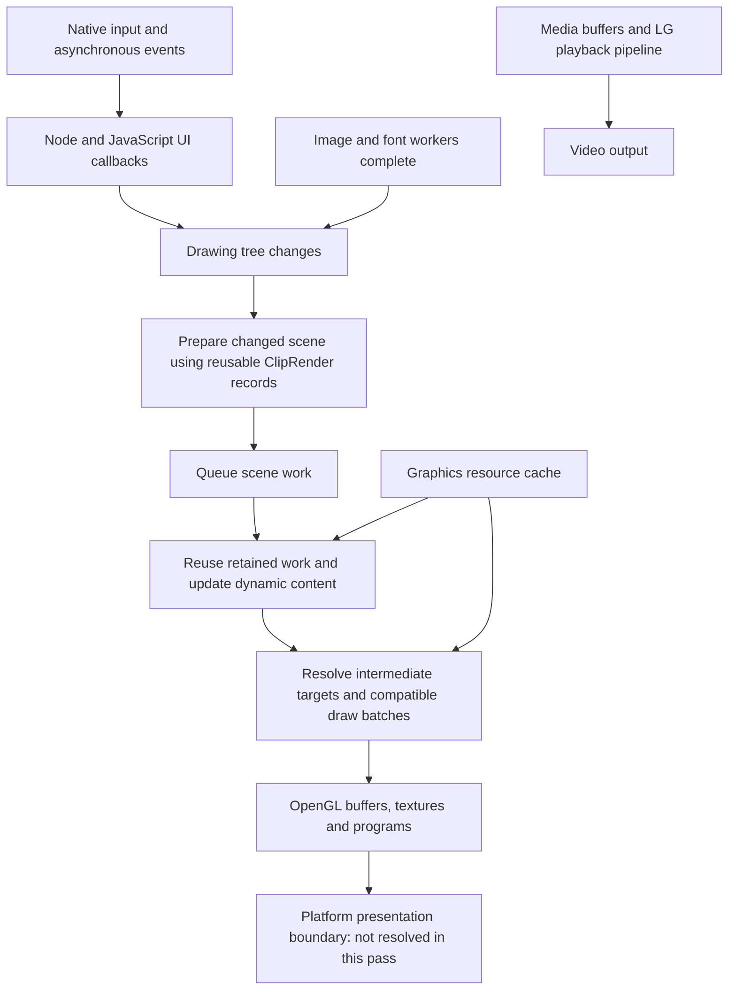

# Elements of A: CPU, memory and graphics implementation map

**Completed:** 16 October 2026. **Scope:** the retained LG webOS native reference runtime; ordinary UI, asset, resource and scheduling mechanisms. No TV access or application execution was performed for this study.

## 1. What this pass adds

We now have implementation-level evidence for frame-request coalescing, command/scene reuse, worker scheduling, an actual small-object arena, shared media-buffer ownership, graphics budget admission, priority/age eviction, offscreen target reuse, compatible-draw batching, texture upload and shader-program lifetime. This goes beyond the earlier function-name inventory.

The investigation exported **135 selected native entry points**, including supporting helpers and platform thunks, plus instruction/literal facts and a graphics vtable. All selected entry points decompiled successfully. This is a focused resource study, not a complete analysis of every runtime function or a live performance benchmark.

### Read the detailed evidence

| Subsystem | Detailed report |
| --- | --- |
| CPU threads, callbacks, frame scheduling, JavaScript heap sampling and stop ordering | [CPU scheduling findings](cpu-scheduling-deep-findings.md) |
| Media arena, shared references, graphics budget, cache admission/eviction and resource release | [Memory and resource findings](memory-resource-deep-findings.md) |
| Scene/render reuse, target validity, batching, uploads, shader cache and synchronization | [GPU rendering findings](gpu-rendering-deep-findings.md) |
| Image fetch/decode/prefetch/cancellation and measurement boundaries | [Assets and observability findings](assets-and-observability-deep-findings.md) |
| Exact selected entry addresses, names, byte counts and local export grouping | [Function manifest](runtime-resource-study-functions.tsv) |

Each detailed report cites native function names and addresses and distinguishes observations, inferences and unknowns. The raw third-party pseudocode stays in ignored local exports. These documents describe mechanisms in original prose.

## 2. Evidence identity and limitations

- **Native artifact SHA-256:** `182704ecaa5277ca837544272ac81cd704a1d0b8eb215afea04d143396d7affa`. The local executable hash matches the analysis project's recorded identity.
- **Architecture:** little-endian ARM32; Ghidra language `ARM:LE:32:v8`.
- **Analysis:** installed Ghidra 12.1.4, existing project, `-readOnly -noanalysis`. The project was reused without reimporting/reanalyzing or saving changes to it.
- **Tool route:** the REA skill guided the staged investigation; native results came from direct Ghidra headless scripts because the connected REA native provider was not configured. These results must not be cited as REA MCP Evidence IDs.
- **No measurements:** no new CPU/GPU utilization, allocation-rate, frame-time, display-latency or memory snapshots were collected. Historical observations retain their separate dates and artifact uncertainty in the older reports.
- **Decompiler limits:** float calling conventions, structure returns and GL function prototypes are sometimes incomplete. Constants and vtable slots were checked separately where needed; unresolved fields are not presented as recovered C++ types.

## 3. The working model in plain English

The graph separates scene preparation, rendering and final output. It does not imply a proved thread assignment for every box, a specific final video plane or a measured synchronization relation between graphics and decoded video. Sources: `AppEngine::internalDraw` (`0x004b566c`), `IEngine::processFrame` (`0x002e8bc8`), `renderFrame` (`0x002e80b4`), `ClipRender::renderFrame` (`0x0030acc8`) and the earlier [media system map](Elements-of-A-system-map.md).

## 4. CPU: it controls how much work reaches the frame

### One outstanding JavaScript frame request

**Observed:** `Luna::AppEngine::internalDraw` (`0x004b566c`) uses a pending-request flag. If a frame callback is outstanding, elapsed input accumulates for a later request instead of repeatedly appending another frame request. `handleNodeCallback` (`0x004b5f2c`) consumes the prepared request on the JavaScript side. `waitNextFrame` (`0x004b2c3c`) receives completed frame information and retains it for later use.

**Why it matters — inferred:** the UI can avoid building a backlog of increasingly obsolete frame callbacks. Some modes overlap preparation of the next JavaScript update with use of the prior completed frame information. This is not proof that every native input event is discarded/coalesced or that display buffers are triple buffered.

### Wakeups carry notifications; queues carry work

**Observed:** `NodeJsMT::doCallback` (`0x004c05a0`) queues a token, posts a semaphore and wakes the Node loop. `asyncCallbackMain` (`0x004c0004`) drains tokens and snapshots listeners under a lock before invoking them. Worker wakeup (`0x004bfbc4`) visits registered worker event loops. The notification itself is not the complete callback payload.

**Why it matters — inferred:** this separates scheduling from event identity and avoids relying on one wakeup per logical event. Ownership and cancellation still need explicit rules; the stop path can discard pending tokens.

### Thread roles and shutdown are explicit

**Observed:** `Platform::Thread::startThread` (`0x00104f64`) looks up named configuration. `cw_threadCreate` (`0x00105b9c`) applies an optional stack size before creating a pthread. The other optional configuration word is only printed in this wrapper; no OS priority/affinity assignment appears in this body. `stopThread` (`0x0010503c`) joins; callers must request shutdown first. `NodeJsMT::stop` (`0x004bfa4c`) and `start` (`0x004c0308`) have a completion-semaphore relationship. Worker-loop cleanup uses libuv closure, listener removal and eventual free through the close callback (`0x004bf7f0`).

**Unknown:** configured stack sizes, scheduling changes elsewhere and actual distribution across CPU cores. Many threads do not establish efficient parallelism by themselves.

## 5. Memory: several independent ownership domains

### Small media metadata uses an arena

**Observed:** `Media::Memory::Pool::relocate` (`0x0029a98c`) allocates **4,096-byte backing blocks**, rounds requests to **8-byte granularity**, reuses blocks after `clear` (`0x0029a8b0`) and can grow the most recent allocation in place when space permits. Larger relocation uses a new location and copies previous bytes. The rounded single-allocation assertion makes **4,088 bytes** the largest accepted rounded request in this implementation; it does not cap the whole pool. `~Pool` (`0x0029a864`) frees all backing blocks and their pointer storage.

**Why it matters — inferred:** repeated small sample/segment metadata operations need fewer independent allocator calls, while the pool's owner supplies the release boundary. The pool can grow through more blocks and is not a 4 KiB global memory limit.

### Large media data has shared ownership and accounting

**Observed:** `ContiguousMemory::create` (`0x000f8bf0`) creates an 80-byte wrapper around a `SharedBuffer::Reference`. `addRef` (`0x000f8ca4`) and `release` (`0x000f8d9c`) govern wrapper lifetime. The SharedBuffer reference uses shared-count control-block ownership. `Allocator::increaseMemory` (`0x000f8b20`) and `decreaseMemory` (`0x000f8b3a`) only update a protected byte counter; they do not allocate payloads. The accounting owner's destructor (`0x000f8a58`) asserts no accounted bytes remain.

**Why it matters — inferred:** references can survive asynchronous parser/source-buffer/track-pump handoffs without a payload copy in this wrapper's constructor. This is not proof of end-to-end zero-copy playback, physical contiguity or decoder/GPU memory placement.

### Graphics memory has admission rules, not just cleanup afterward

**Observed:** `IEngine::IEngine` (`0x002e7ba8`) supplies a **50 MiB default tracked graphics budget only when its Config pointer is null**. A configured path uses supplied values and subtracts **8 MiB plus an estimated display surface**. `setMaxSurfaceMemory` (`0x002e72e4`) rejects requests no larger than that reservation. The actual application's configured value/constructor branch is not established.

**Observed:** `ScratchpadCache::loadTexture` (`0x003077e0`), `initRenderTarget` (`0x00307b70`) and `bindBuffer` (`0x0030756c`) account for resources before creating new backing. They reuse cached objects, reclaim eligible unused resources, retry, and can report failure. Resource objects and their resident graphics handles have separate lifetimes. `releaseHandles` (`0x00306568`) can drop graphics backing while preserving registered objects.

**Observed:** eviction uses priority buckets and frame-counter ages, not a universal LRU. Default minimum age is three cache increments; one eligible bucket's score receives a ×100 weight. `endFrame` (`0x00308218`) additionally prunes one unused scratchpad bucket when it has at least **301 objects** and its head is at least **11 increments** old. These counts do not limit every cache to 300 images. Pipeline draining can advance the age counter, so these are not millisecond delays.

**Unknown:** total application memory budget, unique physical media backing, decoded-image CPU peaks, driver overhead and whether actual runtime configuration overrides those defaults. Lowering a budget cannot guarantee immediate compliance while live resources remain referenced.

## 6. GPU: retained work, reusable targets and compatible batches

### Scene building and scene drawing are separate

**Observed:** the engine constructor initially creates three reusable `ClipRender` records. `processFrame` (`0x002e8bc8`) considers dirty drawing state and completed image/font work before preparing a new scene. `renderFrame` (`0x002e80b4`) can retain the last scene and update dynamic content through `ClipRender::updateDynamicContent` (`0x00309614`). These records are scene-work objects, not evidence of three swapchain images.

**Observed:** `ClipRender::drawTarget` (`0x0030a3e0`) can skip an intermediate scratchpad whose contents are still valid. Temporary creation uses content/state keys and bounded geometry, and a redundant-temporary predicate can avoid an extra surface (`makeTemp`, `0x0030ab00`; `isTempRedundant`, `0x0030e584`).

**Why it matters — inferred:** unchanged scene preparation and valid intermediate results can be reused. This is a concrete way to reduce repeated CPU and GPU work. It does not guarantee that the root target never redraws or that the display stops refreshing.

### Adjacent compatible polygons share draw submissions

**Observed:** `OpenGlRenderQueue::process` (`0x004acbe0`) gathers vertices and flushes batches when state changes. `PolyDrawOp::compareState` (`0x0030e0f0`) checks blend compatibility and shader equality, with camera/group constraints. The draw comparator (`0x0030e130`) has ordering rules; it is not permission to arbitrarily reorder transparent objects. Mesh work uses its own path.

**Observed:** the polygon buffer reserves 65,536 slots and has explicit capacity assertions (`commitToVertexBuffer`, `0x0030e194`; `VertexBuffer::advanceHead`, `0x003182c0`). These helpers do not show automatic capacity-triggered batch flushing. A fixed buffer is not evidence of unbounded geometry support.

### Textures and programs are created when needed

**Observed:** `OpenGlScratchpad::loadTexture` (`0x004ad2a0`) allocates texture handles lazily. `upload` (`0x004ad0ec`) uses `glTexImage2D` with format-specific one/two-plane paths. `bindTexture` (`0x004ad944`) also supports an external-texture target. `ShaderCompiler::enableProgram` (`0x004adc80`) caches programs by type and constructs missing entries through `makeProgram` (`0x004adb34`). `releaseHandles` (`0x004adcac`) clears that program state during the inspected suspension path.

**Unknown:** shader source/math, active effects on a particular screen, driver allocation sizes and how external video textures are supplied/synchronized. An external-texture capability does not prove every video route uses it.

### Resource pressure can cause a GPU wait

**Observed:** `RenderQueue::drainPipeline` (`0x004ac810`) calls the imported `glFinish`. Cache admission/reclamation calls it after attempts to free resources or allocate backing have failed, then retries with adjusted resource-age accounting. This is not shown as an unconditional per-frame wait.

**Why it matters — inferred:** predictable residency and reuse can protect responsiveness by avoiding allocation-pressure stalls. The reference is not magically stall-free; its implementation explicitly handles conditions in which the CPU waits for GPU completion.

## 7. Artwork: demand, preparation and retirement are coordinated

**Observed:** `ImageServer` starts an `ImageProcessor` coordinator (`0x0032302c`); its run method (`0x00322290`) constructs a decoder worker, waits for events and advances loading/decoding/retirement. `ImageProxy::handleClipDistance` (`0x0031c89c`) gates decode requests using a distance/relevance field. `prefetch` (`0x00326a6c`) reuses a stored proxy and feeds ordinary images through the normal decode path. `frameDone` (`0x00326fec`) retires stale task demand using use markers.

**Why it matters — inferred:** making content relevant, fetching its bytes, decoding, uploading and retaining its texture are different operations with different owners. A polished UI can prepare likely-needed assets without treating every item in a catalogue as immediately visible work. Exact distance units, decode priority names and speculative byte limits remain unknown.

## 8. What is established, partial or unresolved

| Question | Result after this pass |
| --- | --- |
| How are JS frame callbacks prevented from backing up? | **Established in the shown producer:** one outstanding request plus accumulated elapsed input. |
| How are tasks and wakeups related? | **Established:** queued tokens/semaphores, loop wakeups and worker registration/cleanup. |
| Does a named allocator actually allocate? | **Established separately:** Pool uses backing malloc; ContiguousMemory accounting methods only count referenced bytes. |
| Are graphics allocations budgeted before creation? | **Established for inspected cache paths**, with limits and bounded retry; actual runtime Config is unknown. |
| How does eviction decide what to free? | **Established substantially:** zero references, numeric priority, frame age and specific cleanup thresholds; enum names remain unknown. |
| Are rendering results reused? | **Established:** retained scene-work records and valid offscreen-target skips. |
| Does it batch GPU work? | **Established:** compatible polygon batches, separate mesh handling and program/state caches. |
| How are assets prepared? | **Established structurally:** fetch/decode task pipeline, proxy reuse, relevance gating and retirement; full scheduling limits are partial. |
| How is memory savings mode implemented? | **Partial:** policy state and main/worker interrupt dispatch are recovered; final policy callbacks' GC/heap actions are unresolved. |
| How much CPU/GPU time or memory does each mechanism use? | **Not measured here.** Static algorithms and budgets are not utilization measurements. |
| What reaches the physical display, and when? | **Unresolved in this pass:** final platform presentation path, exact frame pacing and per-backend video-plane composition. |

## 9. What Buna should take from this

These are proposed independent engineering contracts, not changes implemented in Bloob during this investigation:

1. **Bound obsolete frame work.** Preserve semantic input, but coalesce replaceable visual preparation so an animation cannot build a long queue of stale frames.
2. **Separate invalidation from wakeup.** Consuming a media/network event should repaint only when visible state or an active animation needs a new result.
3. **Keep prepared work with explicit validity.** A new media-clock value need not rebuild the browsing tree; an unchanged effect group need not recreate its offscreen image.
4. **Reserve before allocating.** Track decoded CPU buffers, queued uploads and resident graphics backing separately, including in-flight reservations and recoverable allocation failure.
5. **Give resources owners and reuse boundaries.** Client release, cache retention, graphics-handle release and full object destruction should be distinct operations.
6. **Make source/task cancellation meaningful.** Reject stale results, stop unnecessary queued work and release task-owned references without inventing forced cancellation capabilities.
7. **Batch safely.** Retain transparency/order constraints while grouping compatible draws and reusing program state where the chosen graphics backend permits it.
8. **Instrument the actual milestones.** Submission duration, GPU completion, physical presentation, process RSS and cached heap statistics must retain their separate meanings.

This strengthens the existing [Buna engine specification](../docs/Buna-engine-specification.md). It does not change the earlier [branch review's](../docs/Claude-branch-review-2026-10-15.md) recommended priority: persistence, session intent, acknowledged seek/tracks and source-operation identity still need correctness work before a broad renderer replacement.

## 10. Reproducibility and retained local inputs

The export grouping in the function manifest corresponds to four ignored local files: `cpu-memory-gpu-decomp.txt` (70), `cpu-memory-gpu-followup-decomp.txt` (30), `cpu-memory-gpu-details-decomp.txt` (28) and `cpu-memory-gpu-lifetime-decomp.txt` (7). `runtime-data-decomp.txt` records instruction/literal checks and the concrete graphics queue vtable. These files contain recovered implementation text and remain local.

[ExportRuntimeDossiers.java](ghidra-scripts/ExportRuntimeDossiers.java) takes an output path followed by selected entry addresses, exports resolved direct callers/callees and decompilation, and omits protected-content lines. [ExportRuntimeDataFacts.java](ghidra-scripts/ExportRuntimeDataFacts.java) checks the tick conversion literal, selected instructions and graphics vtable. The scripts do not execute the target or alter analysis metadata. Run them against the matching existing project with `-readOnly -noanalysis`; do not run simultaneous Ghidra sessions against the same project. Use the installed JDK through process-local `JAVA_HOME`.

The literal check confirmed millisecond ticks. The concrete queue vtable at `0x01231140`, with its callable address point eight bytes later, confirmed begin-rendering, begin-frame, end-rendering, target, process, mesh and release-handles slots. Neither check establishes physical presentation timing.

### Follow-up questions with genuine remaining value

- Trace the final platform graphics presenter and its timing/refresh contract.
- Trace actual startup Config construction to determine the deployed graphics allowance and mode.
- Resolve the final memory-savings interrupt callbacks and global memory-pressure policy.
- Resolve the clip-distance field's producer and semantic names of asset/cache priorities.
- Follow SharedBuffer's final backing allocation/deletion and any higher-level media byte/time caps.
- Inspect shader source and uniform definitions only for a specific effect or cost question.

Actual utilization, cache-hit rate, allocation churn and stalls remain runtime questions. These limits do not erase the concrete algorithms recovered above; they define which conclusions this pass can support.
