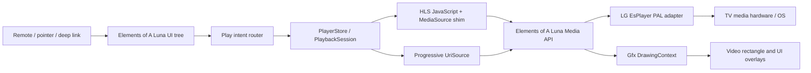

# Elements of A webOS app: system map

This maps the locally extracted Elements of A package, version `16.2.4`, with one read-only observation of the app playing a movie on the user's rooted LG webOS TV. It covers ordinary navigation, playback, rendering, state, and performance behavior. It deliberately excludes protected-content mechanisms. Code in `res/*.js` is shipped, minified JavaScript; the observed device state is identified separately below.

## Evidence and confidence

- `appinfo.json` identifies a native entry executable and a 1920×1080 display target.
- The entry executable is a 32-bit little-endian ARM ELF (`e_machine=40`). REA artifact evidence `ev_340fa1aa80828f8a2ebce2c7cbc82073d3c47673298e0436616f0aeb26f7cfd9` records its SHA-256 as `182704ecaa5277ca837544272ac81cd704a1d0b8eb215afea04d143396d7affa`.
- REA JavaScript evidence `ev_cf4f699d3c020dedcc197007ec7d8848f2712e7f432d7ba99fa7d7f0f27991df` parsed 134 JavaScript files in `res` and inventoried 139 relevant files. Its semantic graph reached a result budget limit on several large bundles. The call trace below therefore uses direct excerpts from the shipped files, not an assertion that REA resolved every edge.
- Native symbols and log strings are evidence that components are included, but they do not alone prove a particular path ran on a TV. The live observation below confirms media threads and device use during one playback. The TV's ordinary system logs did not expose the app's internal player events for that run.

## Read-only TV observation: one movie playback

At 17:10 BST on 12 October 2026, the user reported that a movie was visibly playing. SSH access was used only for `ps`, `/proc` inspection, and reading existing logs. No TV files were changed or deleted. The app was PID `14491`, running its own native executable on an aarch64 Linux 5.4 webOS TV. The user then pressed Back and reported being on the movie page; the same process was sampled at 17:12 BST.

| Observation | During visible playback | After leaving playback |
| --- | --- | --- |
| Elements of A resident memory (`VmRSS`) | 358,464 kB at 17:10; 357,360 kB in a second playback sample | 272,612 kB at 17:12 |
| App threads | 74 | 48 |
| Media thread names visible in `/proc/14491/task/*/comm` | `SourceBuffer: v`, `SourceBuffer: a`, `video-queue:src`, `video-app-es:sr`, `video-sink-Queu`, `audio-queue:src` (2), `audio-app-es:sr`, `audio-sink-Queu` (2), `lxvideodec1:src`, `PlayerControlle` (9) | No `SourceBuffer`, video queue, video app, or decoder thread in the selected comparison; one `audio-sink-Queu` and one `PlayerControlle` remained |
| App device descriptors shown by `/proc/14491/fd` | `/dev/vdec`, `/dev/vo`, `/dev/hma`, `/dev/lg/adec0`, `/dev/lg/audio_uimc` within the app's jail | None of these selected video/audio device descriptors remained |

This is strong evidence that this app's process owns an active media pipeline with distinct audio/video source buffers and queues, plus LG video/audio device access, during this playback. It is inconsistent with the idea that the app merely hands a URL to an unrelated stock webOS player UI. It does not by itself identify every native call, establish which hardware blocks decoded each frame, or measure startup latency. A separate `starfish-media-pipeline` process existed on the TV, but this observation did not establish that it belonged to this Elements of A playback.

The normal `/var/log/messages` entries available during inspection showed app launch and surface visibility but no detailed current playback events. `journalctl _PID=14491` returned no app entries for the checked interval. Consequently, the line-by-line player sequence below is supported by shipped code, while the playback-versus-exit resource difference is supported by live `/proc` observations.

## Native ARM decompilation: player to LG adapter

Ghidra 12.1.4 imported the entry executable as `ARM:LE:32:v8:default` and completed autoanalysis on 12 October 2026. The project is local and untracked under `research/ghidra-projects/`. A focused export in `research/native-media-functions-analyzed.tsv` found 356 functions matching playback-related names. This is an inventory, not a claim that all 356 ran in the observed movie. Targeted decompilations are in `research/lg-playback-decomp.txt`, `research/mse-pipeline-decomp.txt`, and `research/native-transition-decomp.txt`. Decompiler types, variables, and indirect-call signatures can be imperfect; the claims below follow identifiable calls and conditions. Protected-content branches are outside this map.

| Function and entry address | Decompiled behavior |
| --- | --- |
| `Media::MsePlayer::play(BaseSource, Json)` `000e8270` | Parses play arguments, subscribes to the source, then calls `playSource`. The separate `play(string, Json)` overload at `000e016c` aborts and is not the source-based path. |
| `Media::MsePlayer::playSource` `000e7ed8` | Stores the source and options, changes state, emits status, calls `setupCurrentSource`, then `tryPlay`. |
| `Media::MsePlayer::setupSourceBuffer` `000e4e2c` | Reads MIME/track information, obtains track buffers, makes audio/video track records, and subscribes to source-buffer events. |
| `Media::MsePlayer::tryPlay` `000e7d84` | Seeks source buffers to a usable position, updates position/status if needed, locks track buffers, attempts play, then unlocks them. Here “locked tracks” means synchronization around track buffers. |
| `Media::MsePlayer::handleUnderrunEvent` `000e3ce8` | Signals track pumps, pauses on an underrun, resumes on recovery, updates buffering state, and emits status. It has a separate path while awaiting a position. |
| `Media::MsePlayer::setVideoWindow` `000dfeb8` | Checks for positive dimensions, then calls player virtual slot `0x28` with the rectangle. The LG adapter vtable maps that slot to `LgEsPlayerPalImpl::setVideoWindow` at `000cb8c4`. |
| `LgEsPlayerPalImpl::prepare` `000ccfa0` | Builds audio/video ES metadata, calls `create_lg_pipeline`, invokes pipeline setup, registers an event delegate, initializes buffer state, and handles setup errors. |
| `LgEsPlayerPalImpl::submitSample` `000ce1f4` / `internalSubmitSample` `000cdb48` | Checks that the pipeline exists and that its buffer is not full. It assembles sample spans into a reusable vector when needed, submits the sample through an LG pipeline interface method, updates buffer end/EOS state on success, and calls `tryPlay`. This is a native backpressure point. |
| `Media::TrackPump::updatePlayerBuffer` `000ed99c` / `writeDataToPlayerFromLockedTrack` `000ecc48` | Locks a track buffer, gets a sample at its read position, builds a `Media::PAL::EsPlayer::Sample`, and calls the `EsPlayer` virtual slot `0x38`. The LG adapter vtable maps that slot to `LgEsPlayerPalImpl::submitSample` at `000ce1f4`; a successful submit advances the read position and updates a bitrate window. |
| `LgEsPlayerPalImpl::tryPlay` `000cb780` | Returns while the buffer is low; otherwise sends a player event and advances its internal state. This confirms a buffered-start gate. |
| `LgEsPlayerPalImpl::setVideoWindow` `000cb8c4` / `applyVideoWindow` `000cacac` | Updates the stored rectangle only when coordinates differ. The apply path checks geometry, computes placement, and calls LG pipeline interface methods for window/display changes. |
| `Media::MsePlayer::handlePlaybackEnded` `000e8670` | Restarts with a queued next source when present; otherwise marks playback ended and emits status. |
| `Media::MsePlayer::stopInternal` `000e45a8` / `LgEsPlayerPalImpl::stop` `000cd51c` | Clear player resources and stall state; the LG adapter invokes pipeline cleanup, nulls its pipeline pointer/listener, clears async events and `BufferState`, and resets geometry/state. |

The adapter vtable at `01208d4c` provides the two call-edge checks: slot `0x28` stores Thumb pointer `000cb8c5` (`setVideoWindow` at `000cb8c4`), and slot `0x38` stores Thumb pointer `000ce1f5` (`submitSample` at `000ce1f4`). `TrackPump::TrackPump` at `000eaa84` stores an `EsPlayer&` at offset `0x3c`, the pointer used by its submission call. The evidence is in `research/track-pump-constructor.txt`, `research/track-pump-decomp.txt`, and `research/lg-vtable.tsv`.

These are verified static call edges and conditions, not a timestamped trace of every branch in the user's movie. The separate LG pipeline interface's virtual method slots and exact hardware actions remain to be resolved. First-frame time, selected rendition, buffer depth, and output mode were not measured.

## Major layers

The `Luna.Media` API used here belongs to the source app's bundled `components/Luna` and `components/Media` runtime, as indicated by native build paths and symbols in the entry executable. webOS's `luna://` system-service bus has the same word in its name but is a separate interface. The executable also includes `LgEsPlayerPalImpl`, an adapter to LG's ES player interface. The focused decompilation above establishes several native call edges; the remaining indirect LG interface targets need vtable or runtime evidence.

## Representative watch action: click to first frame

1. A product-page control's `released` or `play` handler obtains a button action with `releaseHandler(...)`. For a playable item, it emits `Play` or `PlayWithModal` up the widget tree (`res/ProductPage.js`). Some shelves take a similar route directly from `res/app.js`.
2. The root `Application` handles `PlayWithModal` with a location/offer flow and handles `Play` by calling module `34715`'s play-intent function (`res/app.js`). This is a central navigation boundary: widgets express an intent rather than directly constructing media players.
3. The play-intent function resolves the node type (play entity, movie, episode, show, sports item, or library item). A show can resolve to its current episode. If a product has no playable entry, it emits `ContextualOffers` and returns a result code (`res/app.js`, module `34715`).
4. It checks ordinary viewing prerequisites such as sign-in, profile restrictions, rental confirmation, and rating/age flow. It requires a playable object with `hlsUrl`; failures take separate result or alert paths. This report does not inspect protected-content paths.
5. It sets start-position and playback-context fields, including whether the content is live or autoplay. A slideshow preview may be reused for a seamless transition; otherwise the prior preview is deactivated (`res/app.js`, module `34715`).
6. A loading page is pushed to the UI deck, with transition style chosen for normal, instant, preview, or multiview entry. The app waits for its `mescal` service to be ready and lazily loads `PlayerPage` or `MultiViewPage`. A chunk-load failure shows a content-unavailable alert (`res/app.js`, module `34715`).
7. `PlayerPage.play(...)` restores a start position: explicit override first, then a recent play-position cache, then the library API for library items, or refreshed product data where needed. It asks the shared player service to `play({playEntity, mescalInitTime, ...})` (`res/PlayerPage.js`).
8. `PlayerStore.play(...)` selects a main or secondary player ID, creates reporting and player options, constructs a `PlaybackSession`, registers callbacks, calls `session.start()`, and stores it as a primary or secondary session (`res/PlayerStore.js`).
9. `PlaybackSession.start()` builds a stream URL with `makeStreamURL`, calls `getPlayerInstance().play(url, playerOptions)`, optionally enables content-frame-rate matching, and starts a timer for position-dependent state. `makeStreamURL` can add ordinary playback-context query parameters and an account identifier; this report does not record resulting URLs or values (`res/PlayerStore.js`).
10. The player instance chooses HLS for a URL containing `.m3u8` and progressive otherwise, unless implementation is explicitly forced. Switching players stops the previous one (`res/PlayerStore.js`).
11. HLS constructs/loads an HLS instance, attaches a custom video element, and uses JavaScript `MediaSource`/`SourceBuffer` shims. These create `Media.Source` and `Media.SourceBuffer` objects and append buffered data (`res/6606.js`, modules `47108` and `76179`; `res/PlayerStore.js`, module `22907`).
12. Progressive playback obtains `Media.getPlayer("mse", 0)`, loads the URL through `Media.Streaming.UriSource`, and calls `lunaPlayer.play(source)`. It listens to player state changes for playing, seeking, buffering, position, duration, and errors (`res/PlayerStore.js`, `ProgressivePlayerLuna`).
13. The app's media abstraction exposes the player to `PlayerPage`. The page calls `drawVideo(player, videoRect)` through `Gfx.DrawingContext`, then draws UI overlays (`res/PlayerPage.js`). The native executable contains `Media::MsePlayer`, `Media::PAL::EsPlayer`, and `LgEsPlayerPalImpl` symbols, including `prepare`, `submitSample`, and `setVideoWindow`. Their exact invocation sequence is not yet proven.
14. `PlayerPage.play` resolves its startup promise when the session moves from `PrePlaying` to `Playing`, or when a synchronized session reaches a ready/error state. The HLS reporting code records `playbackStartup` and a first-frame time; those reporting calls are in the shipped code, but no event from a live TV has been captured (`res/PlayerPage.js`, `res/6606.js`).

## During playback and at exit

- `PlayerPage` handles remote play, pause, play/pause, stop, left/right seeking, fast-forward, and back. Scrubbing mode and current overlays can change what a key does (`res/PlayerPage.js`).
- `PlaybackSession` maintains position, buffering, speed, subtitle and audio-track choices, state, post-play eligibility, and optional synchronization. It updates position-dependent session data on a 100 ms interval (`res/PlayerStore.js`).
- A state callback from the Luna media player drives the app's state. `PlayerStore` also updates a flag that suspends the TV screen saver while active playback is in progress (`res/PlayerStore.js`).
- Player-page disposal removes notification callbacks and restores a performance profile. Session-end callbacks stop the selected player, clear its primary/secondary slot, and release screen-saver suspension. A queued next item can delay teardown briefly (`res/PlayerPage.js`, `res/PlayerStore.js`).
- The page can move to post-play or a next/previous episode; the code contains a separate `PostPlayPage` and emits another `Play` intent for an episode transition (`res/PlayerPage.js`).

## Efficiency mechanisms visible in code

These are mechanisms, not measured performance results.

| Mechanism | Static evidence | Expected purpose / open measurement |
| --- | --- | --- |
| Lazy player-page chunks | `res/app.js` awaits a `PlayerPage`/`MultiViewPage` loader | Reduces initial UI load; timing and memory cost need device measurements. |
| Distinct HLS and progressive implementations | URL selection in `res/PlayerStore.js` | Uses different source handling for segmented versus direct media. |
| Preload and reuse | Progressive `queueNext` holds a preloaded `UriSource`; HLS can reuse an instance; queued next item delays teardown | May reduce transition latency; actual benefit requires first-frame timing. |
| Adaptive capability options | `getPlayerOptions` sets bitrate limits, frame-rate and frame-size caps, SD/HDR/4K preferences, and audio options | Controls quality against device capability; need actual selected rendition and dropped-frame metrics. |
| Frame-rate matching | `PlaybackSession.start` enables the media player's `MatchContentFrameRate` option when supported; stop disables it in relevant cases | Could reduce judder; need TV output-mode observation. |
| Native video drawing | `PlayerPage` passes a Luna media player to `Gfx.DrawingContext.drawVideo` | Keeps video and UI composition connected to the runtime's native graphics layer; exact hardware path remains unverified. |
| State and telemetry | HLS startup/first-frame/end reports; Luna state callbacks; player statistics and native diagnostic strings | Provides observability; no actual run's timing, CPU, memory, buffer, or failure trace has been collected. |

## UI and system organization

- `appinfo.json` launches the native entry executable, which hosts the source app's Luna/JavaScript runtime. `res/app.js` creates an `Application extends Window` root with `mainDeck`, tabs, content, menu, profile switcher, notifications, and gamepad hints.
- `mainDeck` is a page stack. The root handles high-level intents (`Play`, `PlayWithModal`, `Route`, search, offers) and pushes pages with transitions. Visible page modules include product, library, search, settings, player, multiview, sports, post-play, and onboarding flows.
- Product and shelf widgets are not responsible for constructing a player. Their click handlers emit typed intents up the tree, along with node/playable context. The root resolves the intent and navigates.
- Data objects called product nodes/play entities hold identifiers, playables, display metadata, and playback context. The root uses shared services/stores for UTS data, account, local storage, cookies, player, preferences, and metrics.
- The player page is a separate page type with its own widgets, overlays, controls, key handling, and playback session. It renders video from the session, while the shared player store owns player instances and sessions.
- Navigation and playback are linked by explicit lifecycle events: page appearance/disappearance, disposal, loading-page cancellation, app minimize/close, and queued next playback.

### Page and interaction responsibilities

| Module | Organization observed in the shipped code |
| --- | --- |
| `res/app.js` | Root `Application extends Window`; owns `mainDeck`, tabs, menu, notifications, profile switcher, shared service access, and top-level intent handlers. `mainDeck` exposes push/pop/top/remove operations. |
| `res/ProductPage.js` | Product page and nested product information/widgets. Button actions are derived from the product node and emitted as typed intents; a play action can route directly, through a modal, or to an offer flow. |
| `res/LibraryPage.js` | Library browsing, family-member context, category/menu state, a right-hand content deck, and a disposable library loader. |
| `res/SearchPageFactory.js` | Search page composition: input, keyboard, result list/content, accessibility suggestions, and search metrics. |
| `res/SettingsPage.js` | Settings page with separate title and settings decks and a settings stack. |
| `res/PlayerPage.js` | Playback surface, controls, remote-key handling, overlays, progress and post-play widgets, with a `PlaybackSession` obtained from the shared player store. |
| `res/MultiViewPage.js` | Multiple video widgets, layout modes, layout controls, and a secondary playback session. |
| `res/WelcomeScreenFlow.js` | Onboarding state machine for initial data, sign-in, and related screens. |

The interaction contract is a useful reusable pattern: leaf widgets send a semantic intent; the root decides whether to navigate, show a modal, or start playback. A page owns its visual composition and input handling; shared stores own account, content, preferences, and player state. These are observed responsibilities, not a claim that every page was traced exhaustively.

## What has not been observed

- One playback and exit were observed through process state and user-reported screen state. A timestamped remote key event, internal player callback, and first-frame event were not captured. The detailed click-to-first-frame sequence above is a static call path, not a fully instrumented execution trace.
- The app has several click and content variants (shelves, product pages, live sports, library, preview-to-player, multiview). This document traces a representative watch path and identifies branches; it does not assert that every branch takes identical gates or player options.
- Focused ARM decompilation now verifies several player-to-adapter call edges, buffering gates, and cleanup functions. The complete call graph, exact LG virtual method slots, hardware decoder configuration, and actual output-plane behavior remain unverified. Ghidra runs directly on this Windows host; REA's Windows integration limit did not prevent independent Ghidra analysis.
- One-point CPU and before/after resident-memory observations were taken, but no repeated benchmark, network throughput, selected-bitrate, buffer-depth, first-frame, or dropped-frame measurements. Efficiency claims still need controlled runs.

## Next evidence to collect for a complete operating map

1. Trace each watch entry variant through the same intent router: product, shelf, search, library, live, trailer/preview, and multiview.
2. Trace the HLS parser/variant selection, segment fetch, append, buffer, seek, and end-of-stream paths to their native API calls, excluding protected-content branches.
3. Record a nonprotected sample playback on a TV: remote input timestamp, navigation intent, selected player path, source/segment timing, player state callbacks, first frame, buffer levels, output mode, seek, stop, and app lifecycle changes. Avoid logging account values or full URLs.
4. Measure startup time, first-frame time, CPU/memory, bitrate and buffer levels, and dropped frames before calling any mechanism efficient.
5. Resolve the LG pipeline interface's virtual method slots and trace which MSE/adapter branches execute on the TV. Match sample submission, buffer events, first frame, output mode, and teardown with timestamps.
