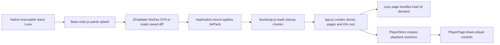

# Elements of A JetPack: offline reverse-engineering map

Date: 2026-10-14. Scope: the local `data/diff.jetpack`, bundled `res/`, and the local reference ARM32 executable. This is static, read-only analysis. No TV files were changed, no content playback was invoked, and no protected-media path was investigated. This report records behavior and architecture; it does not contain extracted application source or assets.

## Executive finding

The saved OTA is **readable and structurally complete**. Its SHA-256 is `c7ddf1a83840c4f24f4078ceb939183f652d6c64990fdb1e59beaeeb48f50ee1`. The native JetPack reader recognizes a v2 root, processes a signed block stream, then a Brotli segment, then a TAR serialization segment. The TAR contains 201 files. The update's `manifest.json` identifies build `16.4.4.J34L139` (2026-09-16); the base `res/manifest.json` is `16.2.4.32L76` (2026-05-15). The update descriptor's `diff.signature` equals the base descriptor's `manifest.id.signature`, tying this diff to this base package.

This corrects the prior uncertainty that the JetPack might be opaque or unavailable for UI analysis. The REA `open_binary` route does not recognize the proprietary JetPack container, but native-reader decompilation plus ordinary structural decoding recovered its file inventory. REA then parsed the extracted JavaScript as inert text: 143 JS files, 2,394,055 AST nodes, no JS parse failures. Its large cross-file semantic graph was **partial** because of analysis result limits. REA Evidence: base `ev_96fb06668f86ec3f08564838cc15c82fe980f27133e8111cee19fe8988325c89`; update `ev_c13f3062de5c4ca184373b809416b4d23313f7a4652a3d57a1462793d9c0daed` (same-session references).

## Container, byte for byte at the structural level

| Layer | Observed value | Reader evidence |
| --- | --- | --- |
| Root magic | `JetPack\n` at offset 0 | `JetPack::readRootSegment` at `0x004ca2b4` compares eight bytes |
| Root version | `2` at offset 8 | `parseRootHeader` at `0x004cc764`; reader rejects versions below 2 |
| Dynamic region | 32-bit little-endian length `1`, value `1` | `parseRootDynamicRegion` at `0x004cc754` returns true when byte is 1 |
| Signed stream | 40 blocks: 39 data blocks and a final zero-length block; first 38 data blocks are 131,072 bytes, the last is 124,438 bytes | `SignedStreamDecoder::readBlock` at `0x004cb6c0` reads data length, data, 16-bit signature length, signature |
| Signature metadata | 70–72 byte blobs; 40 in total | Observed block inventory; signatures were **not verified by this offline parser** |
| First inner segment | Tag `4` (Brotli), length `5,105,168` bytes, followed by a zero terminator | `readSegment` at `0x004c7f44`; `readBrotliSegment` at `0x004c8f24` |
| Decompressed segment | Tag `3` (serialization), length `12,892,160` bytes, followed by a zero terminator | `readSerializationSegment` at `0x004ca950` |
| Serialized content | TAR, parsed through libarchive in the native reader | Serialization lambda at `0x004ca71c` calls `archive_read_support_format_tar` |
| Archive inventory | 208 TAR members: 201 files and 7 directories; 12,520,838 aggregate file bytes | Local TAR inventory; REA parsed the extracted JS tree |

The reader also has handlers for raw data and other segment tags. Their existence describes **reader capability**, not the path taken by this file. This file's observed path is signed stream → Brotli → TAR. No encrypted segment is present on that observed path.

The native archive API (`JetPack::inspectArchive` at `0x004c7ac0`) creates a reader, receives file-entry callbacks, reads each entry's path, size, modified time and bytes, and sorts `FileInfo` records. The filesystem layer (`JetPackFilesystem::mount` at `0x004c5a58`/`0x004c5cfc`, `mountHelper` at `0x004c5444`) reads `lunajetpack.json`, checks mount identity/diff metadata, and updates its mount records. The offline structural decoder did not verify signatures, so it establishes content structure and hashes, not cryptographic authenticity. The native reader supplies a signature verifier when mounting.

## How the update reaches the UI

The base `res/main.js` is the entry point already executing before the diff mounts. `JSUpdater.start()` honors a stored `disableOTA` flag, makes a conditional request using the saved ETag, mounts a 200 response from memory, saves the diff and ETag, or mounts the saved diff after a 304/network failure. It refuses a zero-length response because an empty mount could erase the effective virtual filesystem. This is an error-handling feature in the shipped code, not a recommendation to manipulate TV storage. It then imports `bootstrap` **after** the mount attempt, so the updated `bootstrap.js` can take effect during that launch. On mount failure it proceeds with the base files. Source: `res/main.js` around `JSUpdater` and the on-frame startup block.

Version distinction discovered in the subsequent engineering-question pass: the updated `main.js` retains the comment about `disableOTA` but no longer contains that executable check. The base check therefore cannot be generalized to the updated loader or a currently active operational kill switch. Which entrypoint the running TV uses was not observed in this pass.

The updated `bootstrap.js` marks launch phases, queues control messages during loading, and starts five chunks in parallel with `Promise.all`: `9279`, `6596`, `6759`, `9021`, and `9509` (`app.js`). Its chunk map names page bundles such as `PlayerPage`, `ProductPage`, `SuperBrowsePage`, `SearchPageFactory`, `LibraryPage`, `SettingsPage`, and optional HLS bundles. This is evidence for split loading and startup instrumentation; it does not measure actual launch speed on the TV.

## What the diff changes

The TAR has 143 JavaScript files, 43 gzip localization files, three JSON files, six font files, two images, three text files, and one `.gz` asset. Against the local base `res/`, 185 paths are replacements with different SHA-256 hashes, 16 paths are new, and none of the overlapping files is byte-identical. Ten entries are zero-length: seven older numbered JavaScript chunks and three older symbol-font format entries. They contain no current implementation; relevant current configuration is in the nonempty bundles. The 59 base-only files include configuration and many fonts. This archive is a diff, so absence from the TAR is **not** evidence that a base file was deleted from the runtime view.

New paths include `SuperBrowsePage.js`, seven numbered JS chunks, a locale/advisory bundle, symbol fonts, a card glow image, and a multiview background image. Large updated bundles include `app.js` (2,799,500 bytes), `PlayerPage.js` (354,712), `PlayerStore.js` (133,390), and `ProductPage.js` (114,152). `SearchPageFactory.js` grows from 31,523 to 43,773 bytes. These are byte-size comparisons, not claims that the growth itself improved UX.

The new `SuperBrowsePage.js` has a dedicated page, shelf and filter system: `SuperBrowsePage`, `SuperBrowseShelf`, `SuperBrowseFilterBar`, `LiquidList`, `LiquidMenu`, single/multiple choice menus and a profile menu. Its source shows focusable menu widgets, key input, optional pointer-axis input, animated expand/collapse state, and image prefetch before crossfading a shelf image. This gives a concrete example of the reference UI's **stateful widget composition**: the page owns shelves and focus, while each menu owns its own transition and input handling.

The updated `app.js` contains a `SumTree` with uniform and nonuniform implementations for child sizes. That supports efficient position/index calculations in lists whose items have differing measured sizes. It also has `CanvasWidget` and `CanvasBodyWidget` composition, native `Gfx.DrawingContext` drawing, focus/transition infrastructure, a `GlimmerLoadingView` for placeholders, a `ContentImageryStore` that loads rating/advisory imagery concurrently, and a `PopupTransition` that can idle the page beneath a popup. These are **static code mechanisms**. Their contribution to frame rate still requires runtime measurement.

The updated `PlayerPage.js` contains `PlayerPage`, `UnifiedPlayerWidget`, `TransportBar`, `PlayerUiState`, thumbnail/controller code, post-play widgets, and a newly added `ServerSideMultiViewOverlay`. `TransportBar` stores a dragging position distinct from playback position, handles thumbnail visibility with a 3-second hide timer, and converts pixel positions to media time. `PlayerUiState` records full/reduced mode and uses an animated reduction during trickplay. The page sends seek/pause/resume actions to a playback session; it does not own the media engine directly.

The updated `PlayerStore.js` owns the playback session lifecycle and player selection. The visible unprotected route chooses HLS for `.m3u8` and a progressive Luna URI source otherwise. Its HLS bridge uses a worker and message passing; the progressive route uses Luna `Media.getPlayer("mse", 0)` and `Media.Streaming.UriSource`. The store tracks primary/secondary sessions, state, buffering, position, duration, track selection, preload, reporting and teardown. The player UI reacts to this state. This is the clearest code boundary for Bloob to imitate conceptually: **session state and native media transport below an app-owned control surface**.

## What this teaches Bloob

1. **Use the system media path for decoding and output.** The reference's `PlayerStore` selects a native Luna progressive or HLS path, while `PlayerPage` stays an app-owned control layer. Bloob can preserve that separation with supported webOS media APIs; this archive does not confer Luna APIs on another app.
2. **Treat navigation as a widget/state system.** The new browse page has owned focus, animated filter menus, shelf slots, prefetch and crossfade. A fast UI depends on predictable state changes and bounded work per interaction.
3. **Load only what the first screen needs.** The bootstrap loads defined startup chunks together; named page bundles are lazy. Instrument launch stages and defer routes that are not visible.
4. **Keep scrolling cost proportional to visible content.** The list size trees and shelf slot reuse are stronger evidence than a general claim that the UI is fast because it is native. These structures reduce repeated measurement and layout work.
5. **Make player controls a proper state machine.** The transport bar distinguishes playback time, drag preview and thumbnail state, while the store owns session timing and media events. Bloob's seek bar and track menus should consume one authoritative playback state rather than infer from UI gestures.
6. **Stage update/fallback carefully.** JetPack's role is deployment: it changes effective JS and assets before bootstrap and retains a base fallback. This is separate from rendering performance.

## Evidence limits

- This is a **full structural decode and inventory of this specific JetPack**, plus focused native and JS static analysis. It is not a function-by-function audit of all 143 JS files or a live performance trace.
- REA parsed the updated JS tree but reported partial semantic-graph coverage due to result-budget limits. A missing relation in that graph does not prove code is absent.
- The offline parser did not check cryptographic signatures. The matching manifest/diff identifiers and successful parse support that this is the update for the local base, but they do not replace native verification.
- Static code explains possible paths and structure. It does not prove which A/B treatments, feature flags, remote content, or runtime branches the TV used during a given session.
- This pass did not observe the TV loading this exact saved diff. Its file inventory describes the UI that would be available if `Application.mount` accepts this archive, not a claim that every updated page was shown in a live session.
- The analysis intentionally stopped at container structure and app/UI/media architecture. No protected-content internals or key handling were examined.

## Reproduction pointers

- Original artifact: `data/diff.jetpack` (5,108,274 bytes), SHA-256 above.
- Base entrypoint and OTA state machine: `res/main.js`.
- Native reader functions: `JetPack::parseRootHeader` `0x004cc764`; `readRootSegment` `0x004ca2b4`; `SignedStreamDecoder::readBlock` `0x004cb6c0`; `readSegment` `0x004c7f44`; `readBrotliSegment` `0x004c8f24`; TAR handler `0x004ca71c`; archive inspection `0x004c7ac0`; filesystem mount helper `0x004c5444`.
- REA update parent Evidence: `ev_c13f3062de5c4ca184373b809416b4d23313f7a4652a3d57a1462793d9c0daed`.
- Ghidra project: the existing analysis project under `research/ghidra-projects`; decompilation was read-only. Temporary extracted code was kept outside Git for analysis and should not be published.
